# fingrr

**End-to-end encrypted messaging on the AT Protocol. Blind signaling via your own PDS, direct WebRTC transport, optional blind push relay.**

fingrr lets Bluesky users exchange encrypted messages without trusting any server with their content. Identity is your existing Bluesky account. Keys are derived from a secret that never leaves your device. Signaling and offline delivery ride encrypted records on your own ATProto repo; live messages travel over direct WebRTC data channels.



> **Status: proof of concept. Not audited.** Messages to offline peers are delivered via encrypted ATProto inbox records (store-and-forward on your own PDS); live messages use WebRTC. Do not use fingrr for anything requiring production-grade security guarantees until an external audit exists. See [CLAIMS.md](CLAIMS.md) for every security claim, its implementation, and the test that proves it, and [THREAT_MODEL.md](THREAT_MODEL.md) for what each adversary can and cannot learn.

---

## How it works

### Identity — your Bluesky DID as the address book

fingrr authenticates via ATProto OAuth (web) or an app password (native). Your ATProto DID (`did:plc:…`) is your address — anyone on Bluesky can be a contact if they also run fingrr.

A second "messaging identity" is derived from a device master key (SecureStore on native; wrapped under a non-extractable WebCrypto key in IndexedDB on web):

```
masterKey (32 bytes)
    ├─ HKDF("ed25519-identity:0") → Ed25519 keypair → did:key:z… (signing)
    └─ HKDF("x25519-ik:0")        → X25519 keypair  (long-term identity key)
```

Signed prekeys and one-time prekeys are **random** (not derived), stored in the encrypted local DB, and deleted on rotation/use — the forward-secrecy argument depends on their erasability.

### Keybundle — public key discovery via ATProto

Published to your own repo under `fm.lysn.keybundle` (rkey `self`):

- `identityKey`, `signedPrekey` — X25519 public keys
- `inboxToken` — 16 random bytes, fresh per session: your pseudonymous routing address. Never derivable from public identity data.
- `sig` — Ed25519 signature binding keys + inboxToken to your `did:key` (domain `lysn-prekey-bundle/v1`)
- `spkId`, `otpks[]`, `otpksSig` — envelope-v2 prekeys, signed under their own domain (`fingrr-otpk-batch/v1`)

Clients **verify these signatures on every fetch**. A compromised PDS cannot substitute keys, strip the one-time prekey batch, or redirect your routing token.

### Encryption

**Envelope v2 (default between fingrr clients): X3DH + Double Ratchet.**
Sessions are established with X3DH (identity key + signed prekey + a one-time prekey when available) and messages flow through a Double Ratchet. Exact properties — no marketing words:

- *Per-message forward secrecy*: each message key is single-use and deleted; chain keys are overwritten on derivation.
- *Post-compromise security*: after a full ratchet round trip in which the compromised party contributes a fresh ephemeral key, an attacker holding a stolen session state can no longer follow the conversation.
- *X3DH with a one-time prekey*: an attacker who later obtains both peers' long-term keys **and** the full ciphertext transcript cannot derive the session key, because the one-time prekey private key was erased at use.
- *Without a one-time prekey* (batch exhausted): the above guarantee only takes effect after the first ratchet round trip.
- *Replay and tamper rejection*: message keys exist exactly once; headers are authenticated as AES-GCM associated data.

The whole v2 payload (sender identity, ratchet header, session id) is wrapped in a sealed-sender outer layer — ephemeral-static ECIES to the recipient's identity key. The wire carries **no** sender, no recipient, no header, no session id. This outer layer provides anonymity, not forward secrecy; compromise of the recipient's long-term identity key exposes ratchet *headers* of captured traffic, never plaintext.

**Envelope v1 (legacy/Lysn2 interop, deprecated):** ephemeral-static X25519 → AES-256-GCM with a signed inner message. No forward secrecy: compromise of the recipient's identity key decrypts all captured v1 ciphertext. v1 also exposes the recipient's `did:key` in the wire `to` field. fingrr still *reads* v1 and *sends* it only to peers that publish no v2 prekeys. **Group messages currently use v1 fan-out** and inherit its properties.

### Transport — ATProto signaling + direct WebRTC

There is **no signaling server**. To connect, the caller writes an `fm.lysn.signal` record to their **own** PDS; the callee polls contacts' repos for records whose rkey starts with their own inboxToken. The entire signal body — including SDP offers/answers and ICE candidates, which contain IP addresses — is sealed to the recipient's identity key before it is written. Records are deleted after the connection establishes.

Every signal body is Ed25519-signed by the sender's messaging identity inside the sealed payload; receivers verify the signature, enforce a freshness window, and resolve the sender by verified identity — a malicious contact cannot impersonate another contact's call setup.

Once connected, messages flow over a DTLS-encrypted WebRTC data channel.

**Voice/video calls**: media is DTLS-SRTP with ephemeral per-call keys, peer-to-peer. Because the SDP (which carries the DTLS certificate fingerprint) is identity-signed, call media keys chain up to the same identity root as messages. Contacts can additionally compare **safety emoji** (shield icon in any chat): both devices derive the same 12-symbol emoji sequence from the two identities — matching symbols rule out a key-substitution MITM. The exact 60-digit number sits behind a "show as numbers" toggle.

**IP addresses, plainly:**
- On a direct connection, **peers see each other's IP**. That is inherent to P2P.
- STUN servers (Google, Cloudflare by default) see your IP and nothing else.
- TURN is **off by default** — we operate no TURN server. If you configure your own (`EXPO_PUBLIC_TURN_URL/_USERNAME/_CREDENTIAL`), the TURN operator sees both peers' IPs and relays DTLS-encrypted traffic it cannot read.
- The call screen shows whether a connection is **direct P2P** or **via TURN relay**.

Connect success rates between carrier NATs without TURN have **not** been measured; symmetric-NAT pairs will fail without a TURN server.

### Offline delivery — encrypted inbox records

When the peer is offline, the sender writes the encrypted envelope as an `fm.lysn.inbox` record to the **sender's own** PDS, rkey-prefixed with the recipient's current inboxToken (fetched fresh from their signature-verified keybundle). Recipients poll contacts' repos on startup/reconnect. Records are ciphertext only and are pruned after 7 days. Delivery is sender-side best effort; there is no delivery receipt yet.

### Push — relay-lite (the only server we operate)

`server/` is a ~150-line Fastify service holding one in-memory map: `inboxToken → Expo push token`. On `/ping` it sends a **silent, empty** push so the recipient's app wakes and polls its own inbox. It stores no DIDs, no messages, no ciphertext; restart wipes it. It is rate-limited per IP and per recipient token.

Push transits **Expo's push service and then Google FCM (Android) / Apple APNs (iOS)**. Per notification, Google/Apple and Expo see: the device push token, timestamp, priority, and the payload `{"type":"ping"}` — no message content, no sender, no recipient identity. If that metadata (your device receives *a* ping at time T) exceeds your threat model, disable notifications; the app then learns about messages only when foregrounded. The committed `google-services.json` is an all-zero placeholder.

### Local storage

Message history is stored in SQLite encrypted at rest with **SQLCipher**, keyed via HKDF from the SecureStore master key (native). A forensic image or unencrypted backup yields ciphertext.

---

## Privacy properties

| What | Who can see it |
|---|---|
| Message content | Sender + recipient only |
| Sender identity (v2) | Recipient only (sealed inside ciphertext) |
| Recipient identity on the wire (v2) | Nobody (empty `to`; routing is by random token) |
| Recipient identity on the wire (v1) | Anyone reading the record (`to` = did:key, linkable via keybundle) |
| inboxToken ↔ DID link | Published in your own signed keybundle (pseudonymity is per-session: the token rotates each login) |
| That you run fingrr | Your PDS operator + anyone (keybundle/signal/inbox records are in your public repo) |
| Record timing/sizes | Your PDS operator + anyone watching your repo |
| Group membership (DIDs, handles) | **Anyone** — `fm.lysn.group` records are public (known gap) |
| IP addresses | Your peer (direct); STUN operator; TURN operator if you configure one |
| Push metadata | Expo + Google/Apple: device token, ping timing; our relay: inboxToken ↔ push token |

## Known limitations

- **Groups use envelope v1**: no forward secrecy, and the public group record exposes membership. Both are roadmap items.
- **One-time prekey races**: ATProto has no atomic prekey pop. Initiators pick randomly from the batch; a collision means the second session init is rejected and that sender must retry after the batch republishes.
- **Web build is development-only**: SQLCipher is unavailable (plaintext DB) and, although the master key at rest is wrapped under a non-extractable WebCrypto key in IndexedDB, the unwrapped key necessarily exists in JS memory during use — any XSS is fatal. X25519 is not available as a non-extractable WebCrypto key type across target browsers.
- **Pseudonymity is not anonymity**: your PDS operator sees that your account uses fingrr and when records are written. Content and counterparties are protected; the fact of usage is not.
- **No delivery receipts, no multi-device, no key-change *alerts* yet** (safety numbers exist for manual verification; automatic "contact's key changed" warnings are roadmap).

---

## Architecture

```
fingrr/
├── app/                      # Expo Router screens (onboarding, home, chat, call, contacts, debug)
├── src/
│   ├── crypto/
│   │   ├── keys.ts/.web.ts   # master key storage + HKDF derivation
│   │   ├── didkey.ts         # did:key codec (pure)
│   │   ├── encryption.ts     # AES-256-GCM + X25519 ECIES key wrap (pure)
│   │   ├── message.ts        # Lysn envelope v1 + bundle/batch signatures (pure)
│   │   ├── ratchet.ts        # X3DH + Double Ratchet (pure)
│   │   └── session.ts        # envelope v2: sessions + sealed-sender outer (pure)
│   ├── identity/atproto.ts   # keybundle publish/fetch (signature-verified)
│   ├── transport/
│   │   ├── signaling.ts      # ATProto signal records, sealed payloads
│   │   ├── webrtc.ts         # call peer connection
│   │   └── icetype.ts        # direct vs TURN classification
│   ├── services/
│   │   ├── messaging.ts      # send/receive, v2-with-v1-fallback
│   │   ├── inbox.ts          # offline store-and-forward via own PDS
│   │   ├── prekeys.ts        # SPK rotation, OTPK lifecycle, session store
│   │   ├── group.ts          # group fan-out (v1)
│   │   └── notifications.ts  # push relay client
│   ├── db/                   # SQLCipher-encrypted SQLite
│   └── store/                # Zustand state
├── scripts/                  # test suites (48 in CI + 7 live-PDS, 55 total)
└── server/                   # push relay-lite (Fastify, in-memory, rate-limited)
```

"Pure" modules have no React Native imports — the test suites in `scripts/` run them directly under Node.

---

## Getting started

Prereqs: Node 20+ (24 for the TS test suites), a Bluesky account.

```bash
npm install
npx expo start          # native dev client
npx expo start --web    # web (development only — see limitations)
```

Web + ATProto OAuth: open **http://127.0.0.1:8081** (not `localhost` — loopback client ID requirement). OAuth scope: `atproto transition:generic`.

Run the tests:

```bash
node scripts/test-crypto.mjs                                  # v1 envelope (9)
node --experimental-strip-types scripts/test-ratchet.ts      # X3DH + DR (16)
node --experimental-strip-types scripts/test-session.ts      # envelope v2 + signatures (14)
node scripts/test-atproto-flow.mjs                           # mock-PDS flow (9)
BSKY_HANDLE=… BSKY_APP_PASSWORD=… node --experimental-strip-types scripts/test-live-atproto.ts  # live PDS, v2 (7)
```

Push relay (optional, self-hostable):

```bash
cd server && npm install && node index.js   # PORT, RELAY_SECRET env vars
```

---

## Stack

| Layer | Library |
|---|---|
| App framework | Expo SDK 52 / Expo Router 4 |
| ATProto | `@atproto/api`, `@atproto/oauth-client-browser` |
| Cryptography | `@noble/curves`, `@noble/hashes`, `@noble/ciphers` (audited, zero-dependency) |
| Key storage | `expo-secure-store` (native) / wrapped WebCrypto key in IndexedDB (web) |
| Local DB | `expo-sqlite` + SQLCipher |
| Transport | `react-native-webrtc` |
| Push relay | Node.js + Fastify + `expo-server-sdk` |

---

## Lysn compatibility

Both envelope versions (`fm.lysn.keybundle`, `LysnEnvelope` v1 and v2 with X3DH/Double Ratchet, domain-separated signatures) are wire-compatible with [Lysn.fm](https://lysn.fm) messaging, which publishes the same `spkId`/`otpks` bundle fields and runs the same ratchet; both sides verify this against shared test vectors. fingrr falls back to v1 toward peers that don't publish v2 prekeys. The HKDF labels, signature domains, bundle signed sets, inbox record shape, and ratchet limits are shared constants — neither project changes one unilaterally.

---

## License

Apache 2.0 — © 2026 Creative Mayhem UG (haftungsbeschränkt). See [LICENSE](LICENSE), [PRIVACY.md](PRIVACY.md), [CLAIMS.md](CLAIMS.md), [THREAT_MODEL.md](THREAT_MODEL.md).
